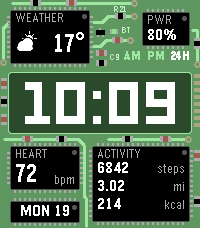
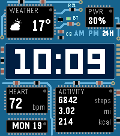
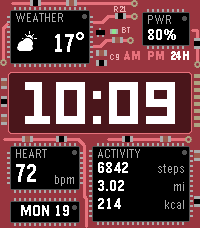
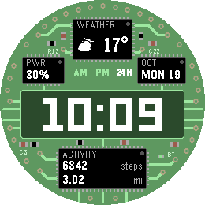
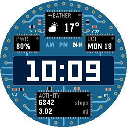
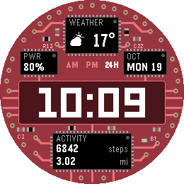

# Circuit

*Your day, soldered onto a circuit board.*

     

A Pebble watchface (v1.0.1).

Circuit turns your watch into a populated circuit board. Copper traces run
between the parts, vias and gold pads line the edges, and every reading has
its own chip: weather, battery, date, heart rate and today's activity.

It looks busy, but it reads at a glance. Every value is set in white on a
black chip, the board itself is only scenery, and the time sits large in a
dark window in the middle of the board.

## What the chips show

| Chip | Content |
|---|---|
| Weather | Current temperature and a weather symbol, refreshed every 30 minutes ([Open-Meteo](https://open-meteo.com), no account needed) |
| PWR | Battery level, `CHG` while charging |
| Date | Weekday and day of the month |
| Heart | Heart rate (Pebble Time 2 only) |
| Activity | Steps, distance and active calories today (distance and steps on Pebble Round 2) |
| BT LED | Green while the phone is connected, red when it is not |
| AM / PM / 24H | The marker that matches your time format lights up |

Everything is drawn in code, nothing is a bitmap, so both displays stay
sharp. The face redraws once a minute and on battery, connection and weather
events.

## Settings

- Solder mask colour - green, blue, red, black or purple.
- Temperature unit - automatic (by phone region), Celsius or Fahrenheit.

12 or 24 hour format follows the watch setting. Distance follows the unit
set in the Pebble app.

## Platforms

- Pebble Time 2 (`emery`)
- Pebble Round 2 (`gabbro`)

## Building

With the [Pebble SDK](https://developer.repebble.com/sdk/):

```bash
pebble build
pebble install --emulator emery
```

The repository can also be imported into CloudPebble as is. For store
screenshots, enable `DEMO` at the top of `src/c/circuit.c`; it fills the
chips with fixed sample values and lets `DEMO_BOARD` pick the colour.

## Release notes

### 1.0.1

The time now sits exactly in the middle of its window; it was three pixels
too low.

### 1.0.0

First release.

## License

MIT License, see [LICENSE](LICENSE). Weather data by
[Open-Meteo](https://open-meteo.com), licensed under CC BY 4.0.
